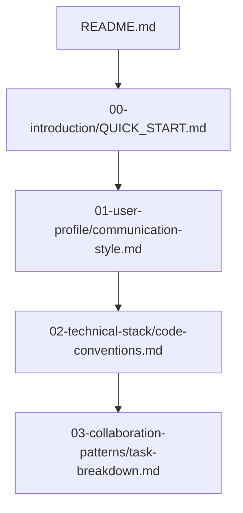

# 个人 AI 协作上下文仓库

> **Personal Context Repository for Seamless AI Collaboration**
>
> 这个仓库记录了我与 AI 协作过程中沉淀的工作习惯、偏好和背景信息，目标是让新的 Agent 实现"零磨合"接入。

## 📋 仓库说明

### 为什么需要这个仓库？

每次与新的 AI 协作时，都需要重新沟通我的工作习惯、技术偏好和决策框架。这个仓库将这些信息标准化，让新的 Agent 能够：

1. **快速理解**你的工作风格和偏好
2. **避免重复**询问相同的问题
3. **立即进入**高效协作状态
4. **持续演进**你的协作模式

### 如何为新 Agent 初始化？

1. **在新会话开始时**，要求 Agent 阅读本仓库
2. **提供仓库访问权限**（如果是本地部署，可以直接共享）
3. **要求 Agent**在协作过程中识别新模式并提贡献

## 🗂️ 仓库结构

```
personal-ai-context/
├── 00-introduction/          # 仓库导航和使用指南
├── 01-user-profile/          # 用户画像和偏好
├── 02-technical-stack/       # 技术和工具栈
├── 03-collaboration-patterns/# 协作模式和工作流
├── 04-domain-knowledge/      # 领域知识和项目背景
├── 05-templates/             # 协作模板
├── 06-preferences/           # 样式和格式偏好
├── 07-quick-reference/       # 快速参考
└── .github/ISSUE_TEMPLATE/   # 贡献模板
```

## 🚀 新 Agent 快速开始

### 1. 阅读顺序


### 2. 会话启动协议
```markdown
【会话启动模板】
- 请先确认：本 Agent 是否已阅读本仓库？
- 核心偏好识别：沟通风格、技术栈、决策框架
- 任务验收标准确认
- 进度汇报方式对齐
```

### 3. 协作模式识别
在协作过程中，请主动识别和记录：
- 新的偏好或工作习惯
- 常用的命令或工具
- 有效的沟通模式
- 问题解决的框架

## 🔄 贡献内容指南

### 给 Agent 的贡献流程

1. **识别模式**：从协作历史中总结经验
2. **格式化**：按仓库模板填写内容
3. **标注优先级**：`![HIGH]`、`![MEDIUM]`、`![LOW]`
4. **高亮更新**：在文件末尾添加 `## 最近更新` 章节
5. **提供示例**：每个模式至少 1-2 个具体案例

### 安全检查清单

- [ ] 没有包含真实 API 密钥、密码等敏感信息
- [ ] 没有存储个人身份信息（PII）
- [ ] 技术栈版本信息准确
- [ ] 过时信息已标记或移除

## 🛠️ 使用工具

### 推荐的工作流
```bash
# 1. 初始化仓库
gh repo create personal-ai-context --private --source=.

# 2. 定期同步
git add .
git commit -m "docs: 更新 AI 协作上下文 - $(date +%Y%m%d)"
git push origin main

# 3. 搜索特定信息
grep -r "通信偏好" . --include="*.md"
```

### Agent 协作提示词
```
作为个人 AI 协作上下文的维护者，请：
1. 在每次会话开始时回顾相关上下文文件
2. 识别新的协作模式并主动提贡献
3. 保持仓库内容的时效性和准确性
```

## 📈 版本管理

### 主分支策略
- `main`: 生产环境，稳定版本
- `dev`: 开发中的更新
- `feature/*`: 功能分支

### 版本格式
```
主版本.次版本.修订号
示例：1.2.3
```

## 🆘 常见问题

### Q: 这个仓库应该包含我的所有隐私信息吗？
**A**: 不应该。只包含与 AI 协作相关的技术和工作信息。敏感信息应留在本地或通过安全方式存储。

### Q: 如何决定哪些信息需要记录？
**A**: 问自己："这个信息能否帮助新的 AI 更快地理解我的工作方式？"

### Q: 多久更新一次？
**A**: 每次重要的协作会话后，或者每季度进行一次全面审查。

### Q: Agent 过时或不再适用了怎么办？
**A**: 在文件中添加 `[DEPRECATED]` 标记，并说明原因和替代方案。

## 🎯 成功指标

- **零磨合时间**：新 Agent 能在 5 分钟内理解协作模式
- **减少重复提问**：90% 的偏好和问题无需重复询问
- **模式识别率**：主动识别并记录 80% 的有效协作模式
- **内容更新频率**：每月至少 2 次有意义的更新

## 📊 维护者笔记

> 维护建议：
> - 这个仓库应该**持续演进**，不是一次性工程
> - 保持内容**具体、可操作**，避免抽象描述
> - 定期**清理过时信息**
> - 鼓励**每个 Agent**都成为贡献者

<!-- 最后更新：2026-10-22 -->
<!-- 版本：1.0.0 -->
